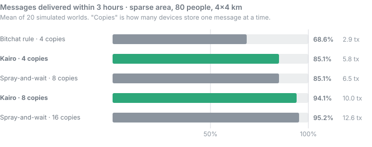
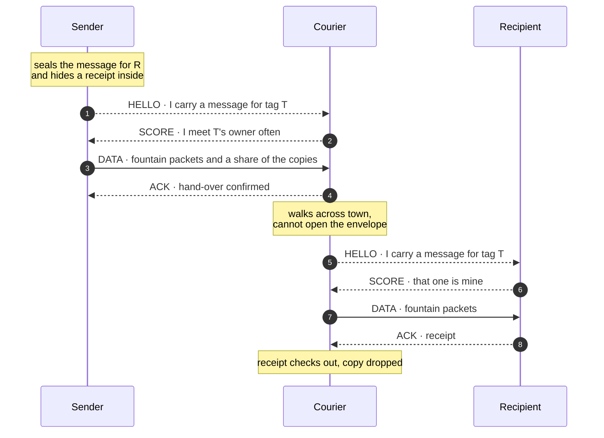

<div align="center">

# Kairo Mesh

**Messages that still arrive when the network is gone.**

An embeddable engine that lets phones carry each other's encrypted messages with no internet,<br>
built for disaster, event and field apps.

[](https://kairodynedynamics.github.io/kairo-mesh/#run)


[](https://github.com/kairodynedynamics/kairo-mesh/actions/workflows/ci.yml)



</div>

## The idea

When cell towers fail or get switched off, phones can still talk to phones nearby. If the person you are writing to is not nearby, someone has to carry your message to them. Kairo decides **who** should carry it, makes sure they **cannot read it**, and makes large content **survive a bad radio link**.

It starts from the idea behind Bitchat and works on what Bitchat's own whitepaper lists as open.

| | Problem | Kairo's approach | Code |
|---|---|---|---|
| 🧭 | Messages are lost when the recipient is out of reach | Couriers chosen by how often they meet the recipient | [`sim.js`](src/sim.js) · [`node.js`](src/node.js) |
| 🧩 | Large content does not complete over lossy links | Fountain-coded fragments: any sufficient set of packets rebuilds it | [`fountain.js`](src/fountain.js) |
| 🎭 | A fixed identifier makes a device trackable | On-air identifier rotates every 15 minutes | [`ids.js`](src/ids.js) |
| 🧾 | Anyone can make couriers drop mail | Delivery receipts only the recipient can produce | [`node.js`](src/node.js) |

## Measured, not claimed

<div align="center">

</div>

"tx" is transmissions per message. The honest reading:

- **At equal cost, Kairo matches blind spraying with half the stored copies** and 10–20% fewer transmissions. Storage is the scarce resource on a courier's phone.
- Against the default budget in the Bitchat whitepaper, delivery rises from 69% to 85% here and from 90% to 99.5% in a denser area, **but with twice the transmissions**. Most of that gap is working harder, not smarter.
- The price is delay: the median is 5–25% longer.
- A 30 KB item completes with **2 to 4.6 times fewer packets** over a lossy link without feedback.

The baseline is our reimplementation of the published rule, not Bitchat's code, and everything above is simulation. Method, limits and what was not measured are in [the validation notes](docs/04-dogrulama.md) (Turkish).

## How a message travels



Tag `T` changes daily and only the recipient's contacts can compute it. A stranger who claims "that one is mine" receives ciphertext and nothing else: without the receipt, couriers keep their copies.

## Run it

Node 24, no dependencies.

```bash
npm test          # 31 tests
npm run bench     # the measurement tables (a few minutes)
node src/cli.js   # chat over the local network
```

In the chat, `/id` prints your pairing code, `/add <name> <code>` adds a contact and `<name> <text>` sends. Run it on two machines on the same network, or twice on one machine with different profiles: `node src/cli.js a.json`.

Or skip the install and [run the simulation in your browser](https://kairodynedynamics.github.io/kairo-mesh/#run).

## Where it stands

| | |
|---|---|
| ✅ | Courier routing rule, simulator and reproducible measurements |
| ✅ | Fountain codec, rotating identifiers, sealed envelopes, delivery receipts |
| ✅ | Working node that chats over a local network |
| ✅ | Android app with Bluetooth LE transport, byte-compatible with the JS node; courier delivery verified on three emulators |
| ✅ | Swift core for iOS (`ios/`), byte-compatible with the JS and Kotlin nodes |
| ✅ | 31 tests in JS (11 attacks, 11 real-world courier scenarios), 13 in Kotlin, 13 in Swift |
| ✅ | Battery-aware courier duty: below 20% battery or in power-saving mode a phone carries only its own mail (low battery verified on Android emulators) |
| ✅ | iOS app (SwiftUI + CoreBluetooth): builds and passes core and UI tests on iPhone and iPad simulators in CI |
| ⬜ | Bluetooth between iPhones (simulators have no Bluetooth; needs real devices) |
| ⬜ | Field test on real phones |
| ⬜ | Independent security audit |

> [!WARNING]
> This is a research prototype. The cryptography is hand-assembled from standard primitives and has not been audited. Do not rely on it for safety.

## Documents

In Turkish: [Bitchat research](docs/01-bitchat-arastirmasi.md) · [Design](docs/02-tasarim.md) · [Validation](docs/04-dogrulama.md)

## Pilot partners

We are looking for one disaster-response, operator or event app to field-test with. [Open a pilot enquiry](https://github.com/kairodynedynamics/kairo-mesh/issues/new?title=Pilot%20enquiry).

## Licence

Open core, dual licensed:

- **AGPL-3.0-or-later** for everyone: open-source apps, research and evaluation use it free.
- **Commercial licence** for closed-source apps, with integration support. Open an issue titled *Commercial licence* to start the conversation.

Contributions are welcome under the terms in [CONTRIBUTING.md](CONTRIBUTING.md).
