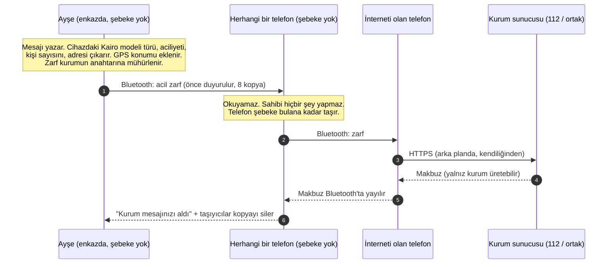

# Acil durum aktarımı: şebekesiz telefondan 112'ye

Kişisel mesajlaşma "en yakındaki birine" bırakılıp beklenebilir. Yardım çağrısı bırakılamaz: yakındaki kişi mesajı görmeyebilir, ciddiye almayabilir, kendisi de yardım bekliyor olabilir. Bu yüzden acil çağrı **bir kişiye değil, bir kuruma** gider. Arada kimsenin bir şey yapması, hatta mesajı görmesi gerekmez.

## Akış

1. **Yazma ve triyaj (cihazda).** Kullanıcı serbest metin yazar. Cihazdaki model mesajı yapılandırılmış kayda çevirir (tür, aciliyet 1–4, kişi sayısı, il/ilçe/mahalle/sokak/bina, özel durumlar, telefon). Kayıt, ham metin ve konum birlikte gönderilir. Model hata yapsa da ham metin kuruma ulaşır.
2. **Konum.** GPS şebeke gerektirmez; enlem, boylam, doğruluk (metre) ve ölçüm zamanı eklenir. Kapalı alanda GPS zayıfsa son bilinen konum ve kullanıcının yazdığı adres birlikte gider.
3. **Mühür.** Zarf, uygulamaya gömülü **kurum açık anahtarına** standart Noise X ile mühürlenir. Taşıyan telefonlar ve ağ geçitleri içeriği, konumu ve göndereni göremez. Kurum, gönderenin kalıcı anahtarını görür (sahte rapor durumunda iz).
4. **Taşıma.** Acil zarf her telefon tarafından taşınır; tanıdık olmak gerekmez. Duyurularda ve iletim bütçesinde öncelik acil zarfındır. Taşıyıcı puanı "bu telefon ne sıklıkla internete erişiyor" ölçüsüdür: zarf, şebekeye çıkma olasılığı yüksek telefonlara yönelir.
5. **Ağ geçidi.** İnterneti olan her telefon, sahibinden onay istemeden arka planda zarfı kurumun sunucusuna yükler. Telefon sonradan şebeke bulursa (enkaz bölgesinden çıkınca) yolda topladığı acil zarfları kendiliğinden yükler.
6. **Makbuz.** Kurum sunucusu zarfı açar, raporu kaydeder ve zarfın içindeki makbuzu döner. Makbuzu yalnız kurum üretebilir; bu yüzden "ulaştı" bilgisi taklit edilemez. Makbuz ağda geri yayılır: göndericiye "kurum aldı" bildirimi düşer, taşıyıcılar kopyalarını siler.
7. **Tekrar.** Aynı zarfı birden çok ağ geçidi yüklerse kurum onu bir kez kaydeder.

## Neden 112'ye doğrudan bağlanmıyor?

112 Acil Çağrı Merkezleri İçişleri Bakanlığı'na bağlıdır; üçüncü taraf bir uygulamanın verisini doğrudan 112 sistemine sokmak resmî bir entegrasyon gerektirir. Bu yüzden mimari kurumdan bağımsızdır: **"kurum" bir açık anahtar ve bir sunucu adresidir.**

| Aşama | Kurum anahtarı ve sunucu kimde | Ne zaman |
|---|---|---|
| Pilot | Kairodyne + ortak kurumun panosu (belediye afet birimi, AKUT, Kızılay) | Saha tatbikatı |
| Resmî | AFAD / 112 kendi anahtarını ve sunucusunu işletir; uygulama o anahtarla dağıtılır | Protokol imzalanınca |

Anahtar uygulamaya gömülü olduğu için resmî aşamaya geçişte kod değişmez; yalnız anahtar ve adres değişir. Aynı anda birden çok kuruma göndermek (112 + yerel afet birimi) aynı zarfı her kurumun anahtarına ayrı mühürleyerek yapılır.

## Kötüye kullanım

| Risk | Karşılık | Durum |
|---|---|---|
| Sahte acil çağrı | Kurum gönderenin kalıcı anahtarını görür; tekrar eden sahte kaynak engellenir. 112'yi asılsız meşgul etmenin yasal yaptırımı uygulama içinde hatırlatılır. | Sunucu tarafı, yapılacak |
| Telefonları sahte acil zarfla doldurmak | Tur başına iletim bütçeleri sınırlı; acil zarflar ayrı kotada tutulmalı ve basit bir iş kanıtı (proof-of-work) istenmeli | Bütçe var; kota ve iş kanıtı yapılacak |
| Ağ geçidinin zarfı yüklememesi | Zarf 8 kopya taşınır; tek bir ağ geçidine bağlı değil | Var |
| Sahte "ulaştı" bilgisi | Makbuzu yalnız kurum üretebilir | Var |

## Kişisel veri (KVKK)

Konum ve sağlık bilgisi özel nitelikli veri sayılabilir. Bu veriyi yalnız kurum açabilir; taşıyıcılar ve ağ geçitleri göremez. Sunucuda saklama süresi, erişim yetkisi ve silme politikası kurumla birlikte yazılmalıdır. Uygulamanın ilk açılışında acil aktarımın nasıl çalıştığı açık rıza metniyle anlatılmalıdır.

## SMS yedeği (yapılacak)

Deprem sonrasında veri bağlantısı çökerken SMS çoğu zaman geçer. İnterneti olmayan ama SMS çekebilen bir telefon, sıkıştırılmış kaydı (`triyaj/uret.py::sikistir`, ortalama ~60 bayt) mühürleyip birleştirilmiş SMS ile kurumun numarasına gönderebilir. Noise X ek yükü 96 bayt olduğundan bir kayıt 2 SMS'e sığar.

## Kurumdan halka (yapılacak)

Aynı kanal ters yönde de çalışır: kurum, kendi anahtarıyla imzalı duyuruları (toplanma alanı, su dağıtım noktası, tehlikeli bina) ağa bırakır; telefonlar imzayı doğrulayıp gösterir ve yayar.

## Kodda ne var

- `src/node.js`: `sendEmergency(rapor)`, ağ geçidi görevi (`online`, `uplink`), acil önceliği, internet erişimine göre taşıyıcı puanı, `onEmergencyDelivered`.
- `src/kurum.js`: kurum tarafı (`createAuthority`), ağ geçitlerinin yüklediği HTTP ucu (`gatewayServer`, `POST /v1/acil`), telefon tarafı yükleyici (`httpUplink`).
- `test/acil.test.js`: 5 senaryo; menzildeki ağ geçidi, şebekesiz taşıyıcının sonradan yüklemesi, öncelik, tekrar ve sahte zarf, HTTP üzerinden uçtan uca.

Kotlin ve Swift düğümlerine taşınmadı; tel biçimi (çerçeveler) değişmedi, yalnız zarf içeriği ve düğüm davranışı eklendi. Sunucu tarafında TLS, kalıcı depolama ve pano yetkilendirmesi yoktur.
