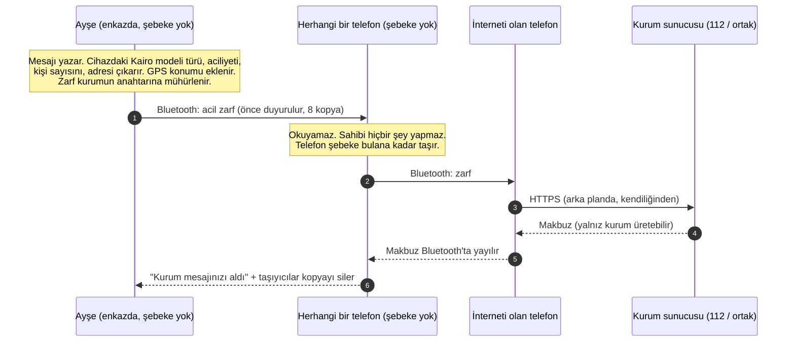

# Acil durum aktarımı: şebekesiz telefondan 112'ye

Kişisel mesajlaşma "en yakındaki birine" bırakılıp beklenebilir. Yardım çağrısı bırakılamaz: yakındaki kişi mesajı görmeyebilir, ciddiye almayabilir, kendisi de yardım bekliyor olabilir. Bu yüzden acil çağrı **bir kişiye değil, bir kuruma** gider. Arada kimsenin bir şey yapması, hatta mesajı görmesi gerekmez.

## Akış

1. **Yazma ve triyaj (cihazda).** Kullanıcı serbest metin yazar. Cihazdaki model mesajı yapılandırılmış kayda çevirir (tür, aciliyet 1–4, kişi sayısı, il/ilçe/mahalle/sokak/bina, özel durumlar, telefon). Kayıt, ham metin ve konum birlikte gönderilir. Model hata yapsa da ham metin kuruma ulaşır.
2. **Konum.** GPS şebeke gerektirmez; enlem, boylam, doğruluk (metre) ve ölçüm zamanı eklenir. Kapalı alanda GPS zayıfsa son bilinen konum ve kullanıcının yazdığı adres birlikte gider.
3. **Mühür.** Zarf, uygulamaya gömülü **kurum açık anahtarına** standart Noise X ile mühürlenir. Taşıyan telefonlar ve ağ geçitleri içeriği, konumu ve göndereni göremez. Kurum, gönderenin kalıcı anahtarını görür (sahte rapor durumunda iz).
4. **Taşıma.** Acil zarf her telefon tarafından taşınır; tanıdık olmak gerekmez. Duyurularda ve iletim bütçesinde öncelik acil zarfındır. Taşıyıcı puanı "bu telefon ne sıklıkla internete erişiyor" ölçüsüdür: zarf, şebekeye çıkma olasılığı yüksek telefonlara yönelir.
5. **Ağ geçidi.** İnterneti olan her telefon, sahibinden onay istemeden arka planda zarfı kurumun sunucusuna yükler. Telefon sonradan şebeke bulursa (enkaz bölgesinden çıkınca) yolda topladığı acil zarfları kendiliğinden yükler.
6. **Makbuz.** Kurum sunucusu zarfı açar, raporu kaydeder ve zarfın içindeki makbuzu döner. Makbuzu yalnız kurum üretebilir; bu yüzden "ulaştı" bilgisi taklit edilemez. Makbuz ağda geri yayılır: göndericiye "kurum aldı" bildirimi düşer, taşıyıcılar kopyalarını siler.
7. **Tekrar.** Aynı zarfı birden çok ağ geçidi yüklerse kurum onu bir kez kaydeder.

## Neden 112'ye doğrudan bağlanmıyor?

112 Acil Çağrı Merkezleri İçişleri Bakanlığı'na bağlıdır; üçüncü taraf bir uygulamanın verisini doğrudan 112 sistemine sokmak resmî bir entegrasyon gerektirir. Bu yüzden mimari kurumdan bağımsızdır: **"kurum" bir açık anahtar ve bir sunucu adresidir.**

| Aşama | Kurum anahtarı ve sunucu kimde | Ne zaman |
|---|---|---|
| Pilot | Kairodyne + ortak kurumun panosu (belediye afet birimi, AKUT, Kızılay) | Saha tatbikatı |
| Resmî | AFAD / 112 kendi anahtarını ve sunucusunu işletir; uygulama o anahtarla dağıtılır | Protokol imzalanınca |

Anahtar uygulamaya gömülü olduğu için resmî aşamaya geçişte kod değişmez; yalnız anahtar ve adres değişir. Aynı anda birden çok kuruma göndermek (112 + yerel afet birimi) aynı zarfı her kurumun anahtarına ayrı mühürleyerek yapılır.

## Kötüye kullanım

| Risk | Karşılık | Durum |
|---|---|---|
| Sahte acil çağrı | Kurum gönderenin kalıcı anahtarını görür; tekrar eden sahte kaynak engellenebilir. 112'yi asılsız meşgul etmenin yasal yaptırımı uygulama içinde hatırlatılır. | Anahtar kayıtta var; engelleme kuralı kurumla birlikte yazılacak |
| Telefonları sahte acil zarfla doldurmak | Her acil zarf 18 bitlik iş kanıtı taşır (gerçek bir çağrı için telefonda bir saniyenin altında, binlerce sahte çağrı için ciddi bir bedel). Taşıyıcılar kanıtsız zarfı reddeder; başkalarının acil zarfları için ayrı kota (24), dolunca en eskisi çıkar. Sunucu da kanıtsız zarfı reddeder. | Var (JS, Kotlin, Swift) |
| Ağ geçidinin zarfı yüklememesi | Zarf 8 kopya taşınır; tek bir ağ geçidine bağlı değil | Var |
| Sahte "ulaştı" bilgisi | Makbuzu yalnız kurum üretebilir | Var |

## Kişisel veri (KVKK)

Konum ve sağlık bilgisi özel nitelikli veri sayılabilir. Bu veriyi yalnız kurum açabilir; taşıyıcılar ve ağ geçitleri göremez. Sunucuda saklama süresi, erişim yetkisi ve silme politikası kurumla birlikte yazılmalıdır. Uygulamanın ilk açılışında acil aktarımın nasıl çalıştığı açık rıza metniyle anlatılmalıdır.

## SMS yedeği (yapılacak)

Deprem sonrasında veri bağlantısı çökerken SMS çoğu zaman geçer. İnterneti olmayan ama SMS çekebilen bir telefon, sıkıştırılmış kaydı (`triyaj/uret.py::sikistir`, ortalama ~60 bayt) mühürleyip birleştirilmiş SMS ile kurumun numarasına gönderebilir. Noise X ek yükü 96 bayt olduğundan bir kayıt 2 SMS'e sığar.

## Kurumdan halka

Kurum, ayrı bir Ed25519 imza anahtarıyla imzalı duyurular yayımlar (toplanma alanı, su dağıtım noktası, tehlikeli bina; en çok 600 bayt, geçerlilik süresiyle). İnterneti olan telefonlar duyuruları birkaç dakikada bir sunucudan çeker (`GET /v1/duyuru`) ve ağa bırakır; her telefon imzayı doğrulayıp gösterir ve dakikada bir yeniden yayar. İmzası tutmayan ya da süresi geçmiş duyuru yok sayılır. Telefonlar en çok 32 duyuru tutar.

## Kodda ne var

- `src/node.js` (ve `android/.../core/Node.kt`, `ios/Sources/KairoCore/Node.swift`, bayt bayt aynı): `sendEmergency(rapor)`, ağ geçidi görevi (`online`, `uplink`), acil önceliği, internet erişimine göre taşıyıcı puanı, `onEmergencyDelivered`, iş kanıtı ve acil kotası, imzalı duyurular (`authoritySign`, `downlink`, `onAnnouncement`).
- `src/kurum.js`: kurum tarafı (`createAuthority`: iş kanıtı denetimi, tekrar eden zarfı bir kez kaydetme, JSON satırlarına kalıcı kayıt, imzalı duyuru üretme), HTTP ucu (`gatewayServer`: `POST /v1/acil`, `GET /v1/duyuru`; anahtarla korunan `GET /pano`, `GET /v1/acil`, `POST /v1/duyuru`), telefon tarafı (`httpUplink`, `httpDownlink`).
- `test/acil.test.js` (8 senaryo), `AcilTest.kt` ve `AcilTests.swift` (4'er): menzildeki ağ geçidi, şebekesiz taşıyıcının sonradan yüklemesi, öncelik, tekrar ve sahte zarf, iş kanıtı olmayan zarfın reddi, imzalı duyurunun yayılması ve sahte/eski duyurunun reddi, sunucu yeniden başlatma, HTTP üzerinden uçtan uca. Platformlar arası: JS kurumu Kotlin ve Swift'in acil zarfını açar; Kotlin ve Swift, JS'nin imzaladığı duyuruyu doğrular.

Henüz yok: uygulama arayüzünde acil çağrı ekranı ve duyuru listesi (çekirdek hazır), sunucuda TLS (ters vekil sunucunun işi), harita destekli pano, SMS yedeği.
